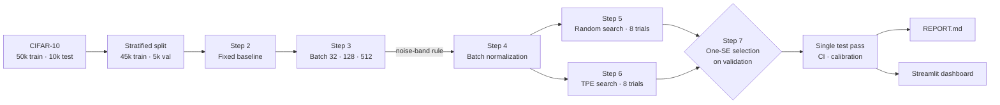

<div align="center">

# Hyperparameter tuning a dense network on CIFAR-10

**Controlled experiments on batch size and batch normalization, then random search against Bayesian optimization at an equal eight-trial budget, with statistically honest model selection.**

[](https://github.com/AnushGoel/cifar10-hyperparameter-tuning/actions/workflows/ci.yml)
[](https://colab.research.google.com/github/AnushGoel/cifar10-hyperparameter-tuning/blob/main/notebooks/Assignment3_Hyperparameter_Tuning_Anush_Goel.ipynb)


[](https://cifar10-hyperparameter-tuning-jrf6jiyoajwtwcedcg5gow.streamlit.app/)
[](LICENSE)

[**Research report**](REPORT.md) · [**Notebook**](notebooks/Assignment3_Hyperparameter_Tuning_Anush_Goel.ipynb) · [**Dashboard**](#interactive-dashboard) · [**Reproduce**](#reproduce-the-study)

</div>

---

## Results at a glance

<!-- RESULTS:START -->
<p align="center"></p>

| Model | Validation accuracy | Test accuracy |
| :--- | ---: | ---: |
| Fixed baseline (512-256-128, Adam, batch 128) | 48.68% | — |
| Best random-search trial | 51.06% | — |
| Best Bayesian (TPE) trial | 53.14% | — |
| **Final selected model** | **53.14%** | **53.05%** (95% CI 52.12% to 54.04%) |

**Final configuration:** 4 hidden layers of 256 units, with batch normalization, dropout 0.4, learning rate 0.0001 and batch size 32; weights from epoch 27, 989,706 parameters, test loss 1.3247, calibration error 0.015.

**Headline findings**

- From the baseline's 48.68% to the final model's 53.14%, tuning changed best validation accuracy by +4.46 pp, a difference that clears both the 1-pp noise band and a paired McNemar test (p < 0.001).
- Ranked by best validation accuracy, batch size 512 came first (49.78%), followed by 128 (48.68%) and 32 (46.94%).
- Taken together, batch normalization did not speed up convergence, did not make training more stable, and reduced the best validation accuracy.
- Bayesian optimization found the stronger configuration under the same budget (2.08 pp ahead, p < 0.001), although a single seed per trial means this ranking could still shift on a rerun.
- In 5 of the 6 fixed 30-epoch runs, validation accuracy peaked at least three epochs before training ended, and keeping the best-epoch weights instead of the last-epoch weights was worth +2.30 pp on average.

<sub>Generated by <code>scripts/build_report.py</code> on 2026-10-22 from 25 runs (49 minutes of training on NVIDIA L4).</sub>
<!-- RESULTS:END -->

## Key insights

| | Finding | Evidence |
| :--- | :--- | :--- |
| 💧 | **Dropout was the decisive hyperparameter** | All 5 dropout-free search trials scored below all 11 trials with dropout (best 45.32% vs worst 45.60%); the mean rose from 43.0% → 47.5% → 50.4% as dropout went 0 → 0.2 → 0.4. |
| 🧪 | **Batch norm alone hurt, by −9.1 pp at batch 512** | It fitted 95% of the training set while validation loss climbed above 4. At 88 updates per epoch, its running statistics (momentum 0.99) lagged about an epoch behind the weights. Paired with dropout and batch 32, it was part of every top configuration. |
| ⏱️ | **The big batch won under a fixed budget** | Batch 512 was 8× faster than batch 32 and 2.8 pp better. Its 2,640 total updates acted as built-in early stopping. With batch norm and dropout added, the trend reversed. |
| 🎲 | **TPE's "win" came from a random warm-up draw** | The 53.14% configuration was trial 2 of 3 warm-up trials, and no guided trial beat it. The guided trials did learn: none was unstable, against 4 for random search. |
| 🎯 | **Honest generalization** | Test accuracy was 53.05% against 53.14% on validation, with an ECE of 0.015. A four-seed mean of 52.13% shows that about 1 pp of the selected score was luck (the winner's curse). |

## What makes this study different

Most tuning write-ups report one winning configuration. This one tries to show how much of each improvement is real.

| | Practice | Why it matters |
| :--- | :--- | :--- |
| 📏 | **A 1-pp noise band and paired McNemar tests** | With 5,000 validation images, accuracy has about 0.7 pp of sampling error. Smaller gaps are treated as ties, not as wins. |
| ⏱️ | **Three clocks for batch size** | Curves are plotted against epochs, weight updates and seconds. Batch 32 makes 1,407 updates per epoch and batch 512 only 88, so epoch counts alone mislead. |
| 🧠 | **Bayesian optimization that actually models something** | Optuna's TPE defaults to 10 random warm-up trials, and KerasTuner's to 15 here, both above an 8-trial budget. A 3-trial warm-up and ordinal encoding make 5 of the 8 trials genuinely model-guided. |
| 🎯 | **One-standard-error model selection** | The final model is the simplest stable run inside the noise band of the best, not just the highest number, which guards against the winner's curse. |
| 🔒 | **The test set is used exactly once** | A single prediction pass yields loss, accuracy, a bootstrap 95% CI, per-class results and a calibration check. |
| 🔁 | **Seed robustness and reproducibility** | The final configuration is retrained over three extra seeds, op determinism is enabled, and every number in the report is regenerated from the logs. |

## Pipeline



## Figures

| Baseline training | Batch size on three clocks |
| :---: | :---: |
|  |  |
| **Batch normalization** | **Random search vs TPE** |
|  |  |
| **Final model on the test set** | **Most confident mistakes** |
|  |  |

All 14 figures, with discussion, are in the [research report](REPORT.md).

## Interactive dashboard
### [](https://cifar10-hyperparameter-tuning-jrf6jiyoajwtwcedcg5gow.streamlit.app/)
`streamlit_app.py` turns the run logs into an explorable lab notebook:

- **Overview:** a contact sheet of test images framed by whether the model got them right, the tuning journey, and the headline findings
- **Batch size:** switch the x-axis between epochs, weight updates and seconds
- **Batch normalization:** a four-panel comparison, plus the learning-rate extension
- **Search lab:** best-so-far curves, a parallel-coordinates view of every trial, hyperparameter effects and coverage maps
- **Final model:** the confusion matrix, per-class accuracy, a reliability diagram, a bootstrap CI, a filterable prediction explorer, and upload-your-own-image classification
- **Training explorer:** overlay any runs on any metric and clock, with smoothing

```bash
make app          # or: streamlit run streamlit_app.py
```

To deploy it on Streamlit Community Cloud, commit the `results/` folder, then choose **New app** and select this repository with `streamlit_app.py` as the entry point.

## Reproduce the study

```bash
git clone https://github.com/AnushGoel/cifar10-hyperparameter-tuning.git
cd cifar10-hyperparameter-tuning
make install
```

1. **Train.** Open the notebook in Colab with the badge above, select an **L4** (or T4) **GPU** and choose **Run all**. It takes under an hour on an L4, and the last cell downloads `results.zip`.
2. **Collect.** Unzip `results.zip` in the repository root, and save the executed notebook over `notebooks/Assignment3_Hyperparameter_Tuning_Anush_Goel.ipynb`.
3. **Report.** Run `python scripts/finalize_notebook.py` to produce the submission notebook (`*_FINAL.ipynb`), then `make report REPO=your-name/cifar10-hyperparameter-tuning`, which renders `REPORT.md`, publishes the figures to `docs/figures/` and refreshes the results block above.
4. **Explore.** Run `make app`.

<details>
<summary><b>What <code>make report</code> does</b></summary>

As the notebook runs, it writes one data-driven sentence per finding to `results/narrative.json`, along with the full histories, search tables and test predictions. `scripts/fill_report.py` substitutes those sentences into the notebook's `{{PLACEHOLDERS}}`, and `scripts/build_report.py` renders `reports/REPORT.template.md` with tables built from the logs. The written analysis therefore always matches the numbers the code actually produced.

</details>

## Repository structure

```text
├── notebooks/
│   └── Assignment3_Hyperparameter_Tuning_Anush_Goel.ipynb   # the full study (Steps 1–9)
├── reports/
│   └── REPORT.template.md          # research-report template
├── scripts/
│   ├── fill_report.py              # fills the notebook's written analysis from results/
│   └── build_report.py             # renders REPORT.md, the README block and figures
├── streamlit_app.py                # interactive dashboard
├── tests/                          # unit and dashboard smoke tests on a synthetic fixture
├── docs/figures/                   # figures published by build_report.py
├── results/                        # run logs exported by the notebook (after training)
├── REPORT.md                       # generated research report
├── .github/                        # CI workflow, Dependabot, issue templates
├── Makefile · pyproject.toml · requirements*.txt · CITATION.cff · LICENSE
```

## Development

```bash
make install-dev   # app + test dependencies
make test          # pytest: report builders and a headless dashboard smoke test
make lint          # ruff
```

CI runs linting, notebook validation and the test suite on every push and pull request.

## Citation

If you reference this work, please cite it with the metadata in [`CITATION.cff`](CITATION.cff); GitHub's **Cite this repository** button generates APA and BibTeX from it.

## Author

**Anush Goel** (NUID 002570173). Built as Assignment 3: Hyperparameter Tuning. The study design, decision rules and analysis are documented in the [report](REPORT.md).
