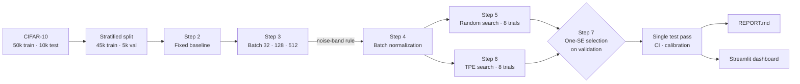

<div align="center">

# Hyperparameter tuning a dense network on CIFAR-10

**Controlled experiments on batch size and batch normalization, then random search against Bayesian optimization at an equal eight-trial budget, with statistically honest model selection.**

[](https://github.com/YOUR-USERNAME/cifar10-hyperparameter-tuning/actions/workflows/ci.yml)
[](https://colab.research.google.com/github/YOUR-USERNAME/cifar10-hyperparameter-tuning/blob/main/notebooks/Assignment3_Hyperparameter_Tuning_Anush_Goel.ipynb)


[](LICENSE)

[**Research report**](REPORT.md) · [**Notebook**](notebooks/Assignment3_Hyperparameter_Tuning_Anush_Goel.ipynb) · [**Dashboard**](#interactive-dashboard) · [**Reproduce**](#reproduce-the-study)

</div>

---

## Results at a glance

<!-- RESULTS:START -->
> Results appear here after the notebook has been run. Run `make report` and this block fills itself with the headline numbers, the final configuration and the tuning-journey figure.
<!-- RESULTS:END -->

## What makes this study different

Most tuning write-ups report one winning configuration. This one tries to show how much of each improvement is real.

| | Practice | Why it matters |
| :--- | :--- | :--- |
| 📏 | **A 1-pp noise band and paired McNemar tests** | With 5,000 validation images, accuracy has about 0.7 pp of sampling error. Smaller gaps are treated as ties, not as wins. |
| ⏱️ | **Three clocks for batch size** | Curves are plotted against epochs, weight updates and seconds. Batch 32 makes 1,407 updates per epoch and batch 512 only 88, so epoch counts alone mislead. |
| 🧠 | **Bayesian optimization that actually models something** | Optuna's TPE defaults to 10 random warm-up trials, and KerasTuner's to 15 here, both above an 8-trial budget. A 3-trial warm-up and ordinal encoding make 5 of the 8 trials genuinely model-guided. |
| 🎯 | **One-standard-error model selection** | The final model is the simplest stable run inside the noise band of the best, not just the highest number, which guards against the winner's curse. |
| 🔒 | **The test set is used exactly once** | A single prediction pass yields loss, accuracy, a bootstrap 95% CI, per-class results and a calibration check. |
| 🔁 | **Seed robustness and reproducibility** | The final configuration is retrained over three extra seeds, op determinism is enabled, and every number in the report is regenerated from the logs. |

## Pipeline



## Figures

| Baseline training | Batch size on three clocks |
| :---: | :---: |
|  |  |
| **Batch normalization** | **Random search vs TPE** |
|  |  |
| **Final model on the test set** | **Most confident mistakes** |
|  |  |

All 14 figures, with discussion, are in the [research report](REPORT.md).

## Interactive dashboard

`streamlit_app.py` turns the run logs into an explorable lab notebook:

- **Overview:** a contact sheet of test images framed by whether the model got them right, the tuning journey, and the headline findings
- **Batch size:** switch the x-axis between epochs, weight updates and seconds
- **Batch normalization:** a four-panel comparison, plus the learning-rate extension
- **Search lab:** best-so-far curves, a parallel-coordinates view of every trial, hyperparameter effects and coverage maps
- **Final model:** the confusion matrix, per-class accuracy, a reliability diagram, a bootstrap CI, a filterable prediction explorer, and upload-your-own-image classification
- **Training explorer:** overlay any runs on any metric and clock, with smoothing

```bash
make app          # or: streamlit run streamlit_app.py
```

To deploy it on Streamlit Community Cloud, commit the `results/` folder, then choose **New app** and select this repository with `streamlit_app.py` as the entry point.

## Reproduce the study

```bash
git clone https://github.com/YOUR-USERNAME/cifar10-hyperparameter-tuning.git
cd cifar10-hyperparameter-tuning
make install
```

1. **Train.** Open the notebook in Colab with the badge above, select a **T4 GPU** and choose **Run all**. It takes about an hour, and the last cell downloads `results.zip`.
2. **Collect.** Unzip `results.zip` in the repository root, and save the executed notebook over `notebooks/Assignment3_Hyperparameter_Tuning_Anush_Goel.ipynb`.
3. **Report.** Run `make report REPO=your-name/cifar10-hyperparameter-tuning`. This fills the notebook's written analysis (`*_FINAL.ipynb`), renders `REPORT.md`, publishes the figures to `docs/figures/` and refreshes the results block above.
4. **Explore.** Run `make app`.

<details>
<summary><b>What <code>make report</code> does</b></summary>

As the notebook runs, it writes one data-driven sentence per finding to `results/narrative.json`, along with the full histories, search tables and test predictions. `scripts/fill_report.py` substitutes those sentences into the notebook's `{{PLACEHOLDERS}}`, and `scripts/build_report.py` renders `reports/REPORT.template.md` with tables built from the logs. The written analysis therefore always matches the numbers the code actually produced.

</details>

## Repository structure

```text
├── notebooks/
│   └── Assignment3_Hyperparameter_Tuning_Anush_Goel.ipynb   # the full study (Steps 1–9)
├── reports/
│   └── REPORT.template.md          # research-report template
├── scripts/
│   ├── fill_report.py              # fills the notebook's written analysis from results/
│   └── build_report.py             # renders REPORT.md, the README block and figures
├── streamlit_app.py                # interactive dashboard
├── tests/                          # unit and dashboard smoke tests on a synthetic fixture
├── docs/figures/                   # figures published by build_report.py
├── results/                        # run logs exported by the notebook (after training)
├── REPORT.md                       # generated research report
├── .github/                        # CI workflow, Dependabot, issue templates
├── Makefile · pyproject.toml · requirements*.txt · CITATION.cff · LICENSE
```

## Development

```bash
make install-dev   # app + test dependencies
make test          # pytest: report builders and a headless dashboard smoke test
make lint          # ruff
```

CI runs linting, notebook validation and the test suite on every push and pull request.

## Citation

If you reference this work, please cite it with the metadata in [`CITATION.cff`](CITATION.cff); GitHub's **Cite this repository** button generates APA and BibTeX from it.

## Author

**Anush Goel** (NUID 002570173). Built as Assignment 3: Hyperparameter Tuning. The study design, decision rules and analysis are documented in the [report](REPORT.md).
