# Hyperparameter Tuning of a Fully Connected Network on CIFAR-10

### A controlled study of batch size, batch normalization and search strategy under a fixed trial budget

**Anush Goel** (NUID 002570173)
Assignment 3: Hyperparameter Tuning

This report was generated on 2026-10-22 by `scripts/build_report.py`, using the experiment logs that `notebooks/Assignment3_Hyperparameter_Tuning_Anush_Goel.ipynb` exported. Every number below comes from those logs. The notebook holds the code, the raw outputs and a step-by-step commentary; this report presents the same study in research form.

---

## Abstract

Hyperparameter tuning is often reported as a single winning configuration with no indication of how much of the improvement is real. I tuned a fully connected network on CIFAR-10 through one-variable-at-a-time experiments followed by two equal-budget searches, making every decision on a stratified 5,000-image validation set with an explicit noise band and paired McNemar tests, and touching the test set exactly once. The fixed baseline reached 48.68% validation accuracy before overfitting. Under a fixed 30-epoch budget, larger batches trained eight times faster and generalized slightly better. Batch normalization on its own let the network memorize its training set and cut validation accuracy by more than 9 percentage points, yet every strong configuration in the searches used it together with dropout, which proved the most decisive hyperparameter: all five dropout-free trials scored below all eleven trials with dropout. Bayesian optimization (TPE) beat random search, 53.14% against 51.06%, but its winning configuration came from a random warm-up trial, not from the model. A one-standard-error rule selected `bayes_t2` (4 hidden layers of 256 units, with batch normalization, dropout 0.4, learning rate 0.0001 and batch size 32), which scored 53.14% on validation and 53.05% on the held-out test set (95% bootstrap CI 52.12% to 54.04%) and was well calibrated (ECE 0.015). The main lessons are methodological: compare batch sizes on every clock, judge batch normalization together with its regularization and batch size, check whether a Bayesian tuner's best result actually came from its model, and treat differences inside the sampling noise of the validation set as ties.

---

## 1. Introduction

A neural network's hyperparameters decide how quickly it learns, how stable that learning is and how well the result transfers to new data. Tuning them is expensive, and with a small budget it is easy to mistake noise for progress: a configuration can look 0.5 points better simply because of the random seed or the particular validation images. This study treats tuning as a small controlled experiment rather than a leaderboard, and addresses four research questions:

- **RQ1.** With everything else fixed, how does batch size affect convergence, stability, computational cost and validation performance?
- **RQ2.** Does batch normalization improve training stability, convergence speed or validation performance at the selected batch size?
- **RQ3.** Under an identical budget of eight trials, how do random search and Bayesian optimization compare in best result, speed of discovery, stability and cost?
- **RQ4.** Which configuration should be selected, and how well does it generalize to data never used for any decision?

The emphasis on controlled comparison follows the brief. The model family (a dense network on raw pixels) is deliberately simple, so the ceiling on accuracy is low, and the interest lies in how reliably each tuning decision can be justified.

**Contributions beyond the brief.** (1) A pre-specified 1-percentage-point noise band and paired McNemar tests for every key comparison. (2) Batch-size curves on three clocks: epochs, weight updates and seconds. (3) A Bayesian search configured so that it is actually model-guided within eight trials. (4) A one-standard-error selection rule, a single test pass with a bootstrap interval, a calibration analysis and a seed-robustness check. (5) A reproducible pipeline that regenerates this report and an interactive dashboard from the run logs.

## 2. Background

**Batch size and gradient noise.** Mini-batch gradients are noisy estimates of the full-data gradient. At a fixed learning rate, the scale of that noise grows roughly with the ratio of learning rate to batch size (Smith et al., 2018), so small batches take many noisy steps per epoch and large batches take a few smooth ones. Very large batches have been associated with sharp minima and weaker generalization (Keskar et al., 2017), but much of that gap closes when the number of updates or the learning rate is adjusted (Goyal et al., 2017; Hoffer et al., 2017), and small batches often train most reliably (Masters & Luschi, 2018).

**Batch normalization.** Batch normalization standardizes each layer's pre-activations over the mini-batch and then applies a learned scale and shift (Ioffe & Szegedy, 2015). It was proposed to reduce internal covariate shift. Later analysis attributes its benefit mainly to a smoother optimization landscape with more predictable gradients (Santurkar et al., 2018).

**Hyperparameter search.** Random search outperforms grid search when only a few hyperparameters matter, because it tries each dimension at many distinct values (Bergstra & Bengio, 2012). Bayesian optimization instead fits a surrogate of the objective and proposes points that balance exploration against exploitation (Shahriari et al., 2016; Snoek et al., 2012). The Tree-structured Parzen Estimator (TPE) models the densities of "good" and "rest" configurations rather than the objective itself (Bergstra et al., 2011; Watanabe, 2023) and is Optuna's default sampler (Akiba et al., 2019).

**Comparing models fairly.** Accuracy on a finite evaluation set is a noisy statistic. When two classifiers are scored on the same examples, McNemar's test on the discordant pairs is the recommended way to compare them (Dietterich, 1998). Seeds, data order and hyperparameter choices add further variance that single-run comparisons ignore (Bouthillier et al., 2021). Repeatedly selecting on a validation set biases its score upward, which is why the test set must be kept separate (Raschka, 2018).

## 3. Methods

### 3.1 Data

CIFAR-10 contains 50,000 training and 10,000 test images of 32 × 32 × 3 pixels in ten balanced classes (Krizhevsky, 2009). Each image was flattened to 3,072 features and divided by 255. A stratified split with a fixed seed separated 45,000 training images from 5,000 validation images (500 per class). Labels were kept as integers for sparse categorical cross-entropy.

### 3.2 Models

| Variant | Architecture | Regularization | Optimizer |
| :--- | :--- | :--- | :--- |
| Baseline (Step 2) | 3,072 → 512 → 256 → 128 → 10, ReLU, softmax | none | Adam defaults (lr 0.001) |
| Batch-norm variant (Step 4) | Same, each hidden block Dense (no bias) → BatchNorm → ReLU | none | Adam defaults |
| Search model (Steps 5–6) | 2 to 4 equal-width blocks Dense → BatchNorm → ReLU → Dropout | dropout 0 to 0.4 | Adam, searched lr |

The Dense layers before batch normalization omit their bias, because the learned shift β makes it redundant (Ioffe & Szegedy, 2015).

### 3.3 Training protocol

Every run used the same seed, set before the weights were created, with TensorFlow op determinism enabled. Each run had a cap of 30 epochs and kept the weights from its epoch of highest validation accuracy. Steps 2 to 4 always trained for all 30 epochs, so that their curves show overfitting in full. Search trials added early stopping on validation accuracy with a patience of 8 epochs, identical for every trial. Batch size 128 in Step 3 reused the baseline run, because the configuration is identical.

### 3.4 Search strategies

Both searches covered the same 432-point grid: learning rate {0.0001, 0.0005, 0.001, 0.005}, batch size {32, 64, 128, 256}, hidden layers {2, 3, 4}, units per layer {128, 256, 512} and dropout {0, 0.2, 0.4}. Random search drew eight distinct configurations with a seeded generator. Bayesian optimization used Optuna's TPE sampler with two deliberate changes from its defaults:

- **A three-trial random warm-up instead of ten.** Optuna's default warm-up (Optuna Contributors, n.d.), like KerasTuner's default of three random points per hyperparameter (Keras Team, n.d.), exceeds an eight-trial budget and would make the "Bayesian" search entirely random.
- **Ordinal encoding.** Each hyperparameter was proposed as an integer index into its value list, so TPE can exploit the ordering of the values while proposing exactly the same values as random search.

### 3.5 Decision rules and statistics

All rules were written into the code before any experiment ran.

| Decision | Rule |
| :--- | :--- |
| Is a difference real? | The standard error of one validation accuracy at *n* = 5,000 is at most 0.71 pp, so a difference between two models has a standard error of about 1.0 pp (the **noise band**). Key comparisons also use an exact paired McNemar test (Dietterich, 1998). |
| Failed trial | NaN loss, or best validation accuracy below 20% (twice chance). |
| Unstable trial | Mean epoch-to-epoch swing in validation accuracy above 2 pp after epoch 5, or any single-epoch drop of 5 pp or more. |
| Batch size for Step 4 | The highest best validation accuracy, unless another setting is inside the noise band of it, in which case the fastest wins. |
| Final model | Among non-failed runs inside the noise band of the top score, keep the stable ones and choose the fewest parameters, breaking ties by lower validation loss; if none is stable, keep the top run. This is a version of the one-standard-error rule (Hastie et al., 2009). |
| Test evaluation | One prediction pass. Loss, accuracy, a 2,000-sample bootstrap 95% CI, per-class accuracy, the confusion matrix and the expected calibration error with 15 bins (Guo et al., 2017) all come from that single pass. |

### 3.6 Implementation

The experiments ran on NVIDIA L4 with python 3.13.15, tensorflow 2.21.0, keras 3.13.2, optuna 5.0.0, numpy 2.1.3. In total, 25 training runs took about 49 minutes.

## 4. Results

### 4.1 Baseline behavior

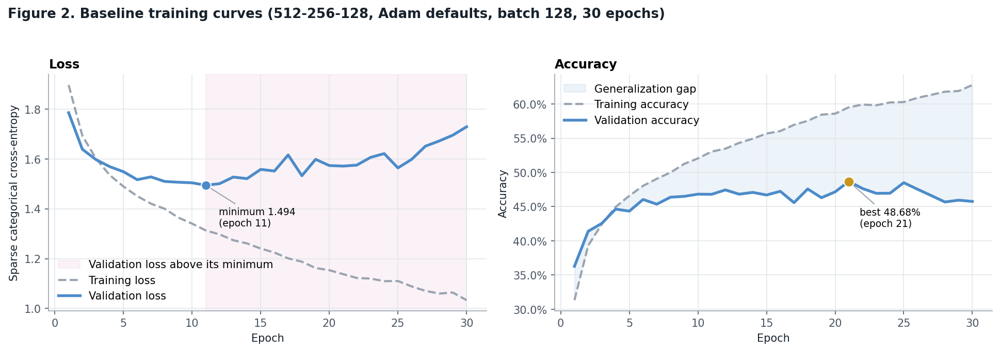
*Figure 2. Baseline loss and accuracy. The shaded region marks epochs after the validation-loss minimum.*

Training loss fell from 1.897 to 1.033, rising in only 2 of 29 epoch-to-epoch steps, and training accuracy climbed to 62.77%. Validation accuracy behaved differently: it peaked at 48.68% in epoch 21 and finished at 45.76%, so the 9 epochs after the peak bought nothing on unseen data. Validation loss reached its minimum of 1.494 at epoch 11 and then climbed 16% by epoch 30 while training loss kept falling, which is the classic signature of overfitting. The gap between training and validation accuracy widened from -4.94 pp after the first epoch to 17.01 pp by epoch 30 (62.77% versus 45.76%). The negative starting gap is an artefact of how Keras reports training accuracy: it is averaged over the epoch while the weights are still improving, whereas validation accuracy is measured at the end of it. After the first five epochs, validation accuracy moved by a typical ±0.98 pp from one epoch to the next, and its largest single-epoch drop was 1.66 pp, so optimization itself was stable; the problem with the baseline is generalization, not stability.

The baseline therefore fits its training data easily but generalizes poorly. A dense layer has no notion of spatial locality, so it must learn the same feature separately at every position. Convolutional layers avoid this through parameter sharing (Goodfellow et al., 2016), which caps what any amount of tuning can achieve with this architecture.

### 4.2 RQ1: Batch size

**Table 1.** Batch-size comparison (30 epochs each, Adam defaults).

| Batch size | Updates / epoch | Best val. accuracy | Best val. loss | Epoch of best accuracy | Updates to best | Training time (s) | Val. jitter (pp) | Selected |
| :--- | ---: | ---: | ---: | ---: | ---: | ---: | ---: | ---: |
| 32 | 1,407 | 46.94% | 1.5434 | 15 | 21,105 | 176 | 0.75 |  |
| 128 | 352 | 48.68% | 1.4942 | 21 | 7,392 | 54 | 0.98 |  |
| 512 | 88 | 49.78% | 1.4522 | 30 | 2,640 | 22 | 0.73 | ✓ |

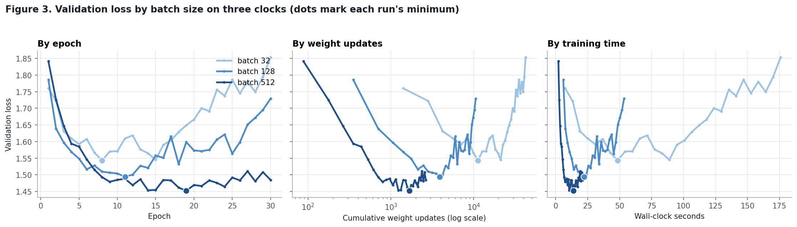
*Figure 3. Validation loss for each batch size against epochs, cumulative weight updates and wall-clock time.*

Ranked by best validation accuracy, batch size 512 came first (49.78%), followed by 128 (48.68%) and 32 (46.94%). The gap between the best and worst setting was 2.84 pp, a difference that clears both the 1-pp noise band and a paired McNemar test (p < 0.001), so batch size did make a measurable difference here. Counted in epochs, validation accuracy peaked at epoch 15 (batch 32), 21 (batch 128) and 30 (batch 512); counted in weight updates, those peaks came after roughly 21,105, 7,392 and 2,640 updates. Small batches reached their best point in fewer epochs only by taking many more steps; per update, the large batch made more progress, because each of its steps averages over 16 times as many images. The lowest validation loss was 1.543 for batch 32 (epoch 8), 1.494 for batch 128 (epoch 11) and 1.452 for batch 512 (epoch 19). By epoch 30 validation loss had risen above those minima by 20%, 16% and 2% respectively, so batch 32 overfit most strongly within the fixed epoch budget. Epoch-to-epoch jitter in validation accuracy (after epoch 5) was 0.75 pp at batch 32, 0.98 pp at 128 and 0.73 pp at 512, so the noisiest curve came from batch 128 and jitter did not simply track batch size in this run. Training took 176 s at batch 32, 54 s at batch 128 and 22 s at batch 512 on this hardware (NVIDIA L4), so batch 32 was about 8.1 times slower than batch 512 for the same 30 epochs.

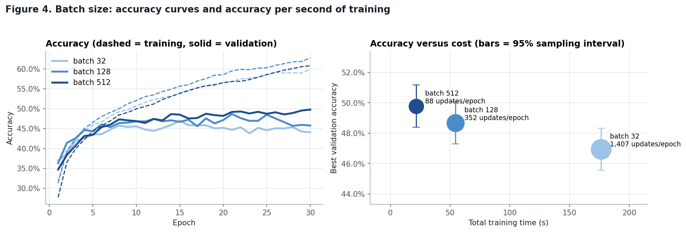
*Figure 4. Training and validation accuracy by batch size (left), and best validation accuracy against training time (right).*

I carry batch size 512 forward. It had the highest best validation accuracy, and no faster setting came within the noise band of it.

The large batch's small advantage runs against the intuition that small-batch gradient noise regularizes and large batches generalize worse (Keskar et al., 2017). The fixed budget is the likely explanation: 30 epochs at batch 512 is only 2,640 updates, fewer than batch 32 makes in its first two epochs, so the large-batch network stopped close to its best point and had little chance to overfit. This is consistent with the view that much of the large-batch gap is about the number of updates rather than batch size itself (Goyal et al., 2017; Hoffer et al., 2017).

### 4.3 RQ2: Batch normalization

**Table 2.** Batch normalization at batch size 512, all other settings fixed.

| Model | Best val. accuracy | Best val. loss | Epoch of best accuracy | Val. accuracy after epoch 1 | Val. jitter (pp) | Train–val gap at epoch 30 (pp) | Median epoch time (s) | Parameters |
| :--- | ---: | ---: | ---: | ---: | ---: | ---: | ---: | ---: |
| Without batch norm | 49.78% | 1.4522 | 30 | 34.72% | 0.73 | 11.0 | 0.65 | 1,738,890 |
| With batch norm | 40.64% | 1.7002 | 22 | 28.30% | 3.04 | 55.7 | 0.76 | 1,741,578 |

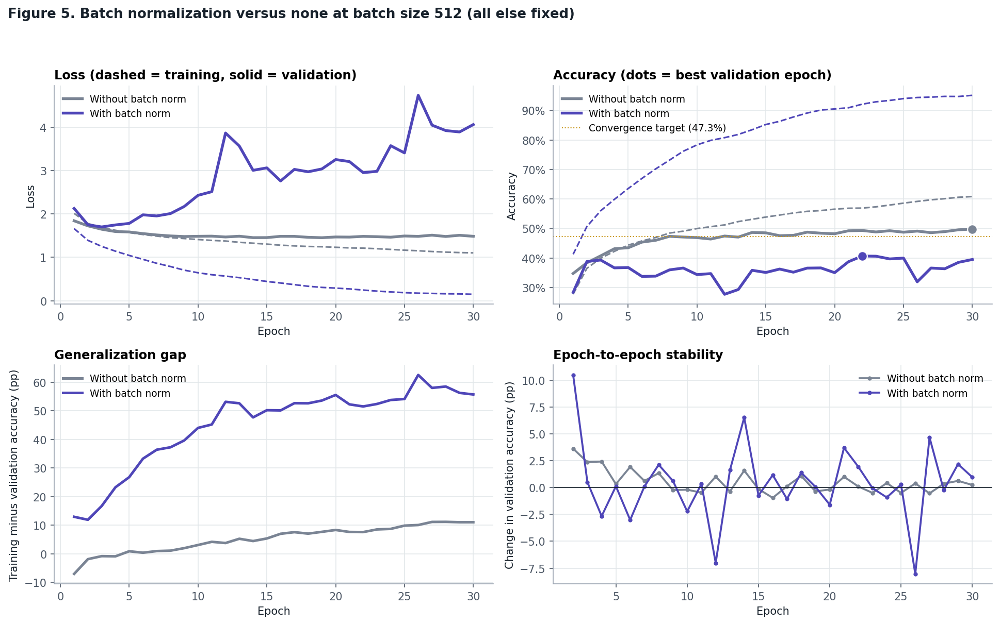
*Figure 5. With and without batch normalization: loss, accuracy, generalization gap and epoch-to-epoch stability.*

With batch normalization, best validation accuracy went from 49.78% to 40.64% (-9.14 pp), a difference that clears both the 1-pp noise band and a paired McNemar test (p < 0.001). The lowest validation loss was 1.700 with batch normalization (epoch 3) against 1.452 without it (epoch 19). The batch-normalized network never reached the 47.3% target, while the plain network did so in epoch 8. After a single epoch, validation accuracy was 28.30% with batch normalization and 34.72% without. Validation-accuracy jitter after epoch 5 was 3.04 pp with batch normalization and 0.73 pp without, and the largest single-epoch drops were 8.04 pp and 0.96 pp, so batch normalization made the validation curve noisier. By epoch 30, the train–validation accuracy gap was 55.68 pp with batch normalization and 11.04 pp without, so the normalized network memorized the training set even more aggressively. Batch normalization changed the median epoch time by a factor of 1.17 (0.76 s versus 0.65 s), a modest overhead for the extra normalization work. Taken together, batch normalization did not speed up convergence, did not make training more stable, and reduced the best validation accuracy.

**Why batch normalization hurt here.** Two mechanisms are visible in Figure 5. First, memorization: batch normalization did speed up optimization, as the literature predicts (Ioffe & Szegedy, 2015; Santurkar et al., 2018). After six epochs the normalized network had 67% training accuracy against 46% for the plain one, and it ended near 95%, while its validation loss climbed above 4, the signature of a confidently wrong model. With no dropout, nothing restrained that. Second, stale statistics: at evaluation time batch normalization uses running averages that Keras updates with momentum 0.99, a window of roughly 100 updates. At batch 512 an epoch has only 88 updates, so after epoch 1 about 0.99⁸⁸ ≈ 41% of the averages still reflected their initial values, and thereafter they described weights from about an epoch earlier. This fits both the poor first-epoch validation accuracy and the jagged validation curve. The verdict therefore applies to batch normalization at large batch sizes without dropout; Sections 4.4 and 4.5 show the same layer inside every strong configuration once those conditions change.

**Extension.** At a learning rate of 0.005, the plain network's best validation accuracy was 47.60% (status: ok, jitter ±0.76 pp) and the batch-normalized network's was 43.08% (status: unstable, jitter ±3.64 pp), changes of -2.18 pp and +2.44 pp relative to the default learning rate. On its face this fits the claim, since the higher rate cost the plain network while the normalized one gained; in absolute terms, though, the normalized network remained both weaker and unstable. Because this changes the learning rate as well, it is reported separately (Figure 6).

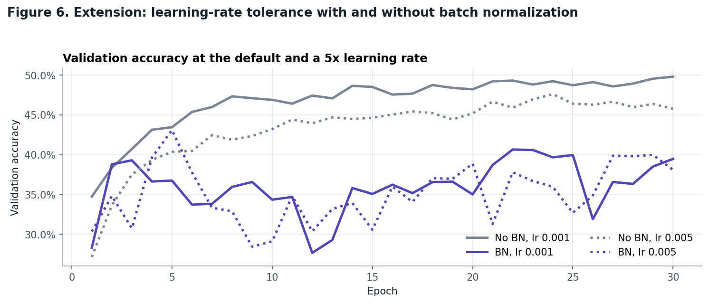
*Figure 6. Validation accuracy at the default and at a five-times-higher learning rate, with and without batch normalization.*

### 4.4 RQ3a: Random search

**Table 3.** Random search, eight trials under the shared protocol.

| Trial | Learning rate | Batch size | Layers | Hidden units | Dropout | Best val. accuracy | Best epoch | Status | Key observation |
| :--- | ---: | ---: | ---: | ---: | ---: | ---: | ---: | ---: | :--- |
| 1 | 0.005 | 256 | 4 | 512 | 0.2 | 46.74% | 26 | unstable | Noisy validation curve (±3.4 pp per epoch); large train–val gap (32 pp) |
| 2 | 0.001 | 256 | 2 | 256 | 0.2 | 45.60% | 7 | ok | Steady training with a moderate train–val gap |
| 3 | 0.005 | 64 | 4 | 128 | 0 | 44.92% | 3 | ok | Peaked early (epoch 3) |
| 4 | 0.001 | 128 | 3 | 128 | 0 | 40.76% | 5 | unstable | Peaked early (epoch 5); noisy validation curve (±2.2 pp per epoch); large train–val gap (19 pp) |
| 5 | 0.0005 | 128 | 4 | 256 | 0.4 | 49.04% | 13 | ok | Small train–val gap, capacity-limited |
| 6 | 0.0005 | 128 | 4 | 512 | 0.2 | 46.26% | 6 | unstable | Noisy validation curve (±4.6 pp per epoch) |
| 7 | 0.0001 | 64 | 3 | 128 | 0.2 | 50.40% | 27 | ok | Steady training with a moderate train–val gap |
| 8 | 0.005 | 32 | 2 | 256 | 0.4 | 51.06% | 23 | unstable | Noisy validation curve (±2.2 pp per epoch) |

The best random-search configuration was trial 8: 2 hidden layers of 256 units, with batch normalization, dropout 0.4, learning rate 0.005 and batch size 32, which reached 51.06% validation accuracy at epoch 23. Across the eight trials, best validation accuracy ranged from 40.76% to 51.06% (median 46.50%), and all eight beat the Step 4 batch-normalized reference of 40.64%. Grouping the trials by each hyperparameter, the spread in mean best validation accuracy was largest for learning rate (7.22 pp between its best value, 0.0001, and its worst, 0.001), followed by dropout (7.21 pp) and batch size (5.71 pp); hidden layers mattered least (2.75 pp). Of the 8 random-search trials, 4 were flagged: trial 1 (unstable; learning rate 0.005, batch size 256, dropout 0.2, best 46.74%); trial 4 (unstable; learning rate 0.001, batch size 128, dropout 0, best 40.76%); trial 6 (unstable; learning rate 0.0005, batch size 128, dropout 0.2, best 46.26%); trial 8 (unstable; learning rate 0.005, batch size 32, dropout 0.4, best 51.06%). The best random trial was itself flagged as unstable, so its score comes with a caveat, and two of the four flagged trials used the largest learning rate. The smallest learning rate, which might be expected to converge too slowly in 30 epochs, produced one of the best and steadiest trials.

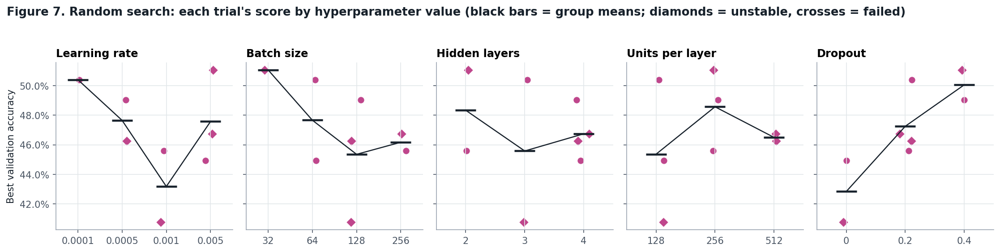
*Figure 7. Each random-search trial's best validation accuracy by hyperparameter value (bars show group means).*

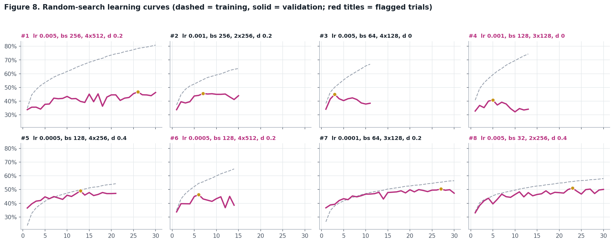
*Figure 8. Learning curves of the eight random-search trials.*

### 4.5 RQ3b: Bayesian optimization and the comparison

**Table 4.** Bayesian optimization (TPE), eight trials: three random warm-up trials, then five model-guided trials.

| Phase | Trial | Learning rate | Batch size | Layers | Hidden units | Dropout | Best val. accuracy | Best epoch | Status | Key observation |
| :--- | :--- | ---: | ---: | ---: | ---: | ---: | ---: | ---: | ---: | :--- |
| random warm-up | 1 | 0.0005 | 256 | 4 | 256 | 0 | 41.04% | 4 | ok | Peaked early (epoch 4); large train–val gap (19 pp) |
| random warm-up | 2 | 0.0001 | 32 | 4 | 256 | 0.4 | 53.14% | 27 | ok | Small train–val gap, capacity-limited |
| random warm-up | 3 | 0.0001 | 256 | 4 | 128 | 0 | 45.32% | 9 | ok | Steady training with a moderate train–val gap |
| TPE-guided | 4 | 0.0001 | 32 | 4 | 128 | 0.4 | 48.50% | 28 | ok | Small train–val gap, capacity-limited |
| TPE-guided | 5 | 0.005 | 32 | 3 | 512 | 0.4 | 51.24% | 28 | ok | Steady training with a moderate train–val gap |
| TPE-guided | 6 | 0.0005 | 32 | 2 | 256 | 0 | 42.78% | 6 | ok | Large train–val gap (21 pp) |
| TPE-guided | 7 | 0.0001 | 128 | 4 | 256 | 0.4 | 49.42% | 21 | ok | Small train–val gap, capacity-limited |
| TPE-guided | 8 | 0.005 | 128 | 3 | 128 | 0.2 | 48.28% | 20 | ok | Steady training with a moderate train–val gap |

The best Bayesian trial was #2 (random warm-up): 4 hidden layers of 256 units, with batch normalization, dropout 0.4, learning rate 0.0001 and batch size 32, reaching 53.14% at epoch 27. The 5 TPE-guided trials averaged 48.04% against 46.50% for the 3 random warm-up trials, but none of them beat the best warm-up trial, so with this little data the surrogate was not yet reliably steering toward better regions. No Bayesian trial failed or met the instability criteria, although trial 5 (learning rate 0.005, batch size 32) had the noisiest validation curve (±1.91 pp per epoch). TPE never proposed the same configuration twice.

**Table 5.** The two search methods under the same eight-trial budget.

| Method | Best val. accuracy | Best trial | First trial within 1 pp of overall best | Median | Std. dev. (pp) | Failed / unstable | Epochs trained | Time (min) |
| :--- | ---: | ---: | ---: | ---: | ---: | ---: | ---: | ---: |
| Random search | 51.06% | 8 | never | 46.50% | 3.34 | 0 / 4 | 164 | 10.0 |
| Bayesian optimization (TPE) | 53.14% | 2 | 2 | 48.39% | 4.14 | 0 / 0 | 190 | 19.1 |

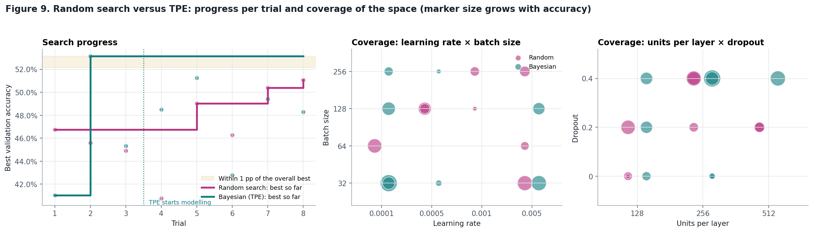
*Figure 9. Best result so far per trial (left) and the regions of the search space each method sampled (centre and right).*

Bayesian optimization's best trial reached 53.14% against 51.06% for random search (+2.08 pp), a difference that clears both the 1-pp noise band and a paired McNemar test (p < 0.001). Taking a strong configuration to mean one within the 1-pp noise band of the best score found by either method (53.14%), random search never got there within its eight trials, and Bayesian optimization first got there in trial 2. Trial scores had a standard deviation of 3.34 pp under random search and 4.14 pp under Bayesian optimization. Random search had no failed and 4 unstable trials; Bayesian optimization had neither. Random search used 10.0 minutes and 164 training epochs in total; Bayesian optimization used 19.1 minutes and 190 epochs. TPE's own overhead for proposing a trial is milliseconds, negligible next to training, so the difference comes almost entirely from which configurations each method chose and how soon early stopping ended them; for example, the mean batch size was 132 for random search and 112 for TPE, and smaller batches cost more time per epoch.

**Where the Bayesian win came from.** Trial 2, the winning configuration, was one of the three random warm-up trials, drawn before TPE had modelled anything, and none of the five guided trials improved on it. The guided trials did learn from the warm-up: four of the five used dropout of at least 0.2, three used dropout 0.4 and three used batch size 32, the settings behind the warm-up winner. That is why none of them was unstable. The headline comparison therefore reflects the luck of a random draw more than the value of the surrogate.

**What mattered across all sixteen trials.** Dropout dominated. Every one of the five dropout-free trials scored below every one of the eleven trials that used dropout (best without dropout 45.32%, worst with it 45.60%), and mean best validation accuracy rose from 43.0% at dropout 0 to 47.5% at 0.2 and 50.4% at 0.4. Batch size reversed its Step 3 trend: with batch normalization and dropout, mean accuracy fell steadily from 49.3% at batch 32 to 44.7% at batch 256, consistent with small batches keeping batch normalization's running statistics current.

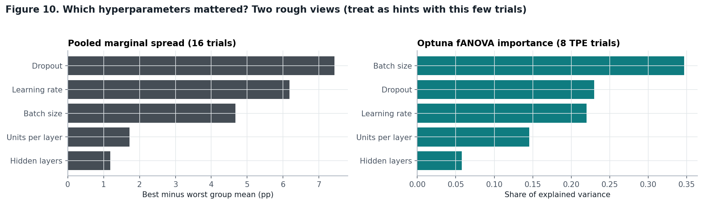
*Figure 10. Two rough views of hyperparameter importance: the pooled spread in group means and Optuna's fANOVA importance.*

### 4.6 RQ4: Final model

**Table 6.** The selected configuration and its held-out results.

| Setting | Value |
| :--- | :--- |
| Hidden layers | 4 |
| Units per layer | 256, 256, 256, 256 |
| Batch normalization | yes |
| Dropout | 0.4 |
| Learning rate (Adam) | 0.0001 |
| Batch size | 32 |
| Epochs | weights from epoch 27 of 30 |
| Trainable parameters | 989,706 |
| Best validation accuracy | 53.14% |
| Test accuracy | 53.05% (95% CI 52.12% to 54.04%) |
| Test loss | 1.3247 |
| Expected calibration error | 0.015 |

The top validation score overall was 53.14% (`bayes_t2`). It was the only run inside the noise band of that score and it was stable, so the rule kept the top-scoring run itself (989,706 parameters). Test accuracy (53.05%) was 0.09 pp below the best validation accuracy (53.14%). A small drop is expected: the validation score was used to choose both the configuration and the epoch, so it is optimistically biased, while the test score is not.

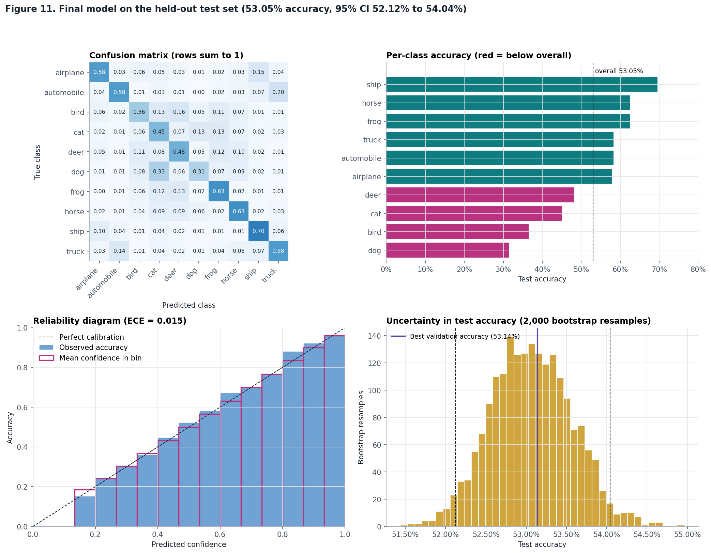
*Figure 11. Test-set confusion matrix, per-class accuracy, reliability diagram and bootstrap distribution of test accuracy.*

Per-class test accuracy ranged from 31.40% for dog to 69.60% for ship. The most frequent confusions were dog predicted as cat (327 images), automobile predicted as truck (196 images) and bird predicted as deer (161 images). More dog images were labelled as cats (327) than as dogs (314), and the other leading confusions pair classes with similar backgrounds and colours, which a dense network on raw pixels relies on heavily. The expected calibration error was 0.015. On average the model was underconfident by 1.20 pp (mean confidence 51.85% against accuracy 53.05%). This is unusually good calibration. Guo et al. (2017) found that miscalibration tends to grow with model capacity and shrink with stronger regularization; a mid-sized network trained with dropout of 0.4 sits at the well-calibrated end, so its probabilities can be taken roughly at face value.

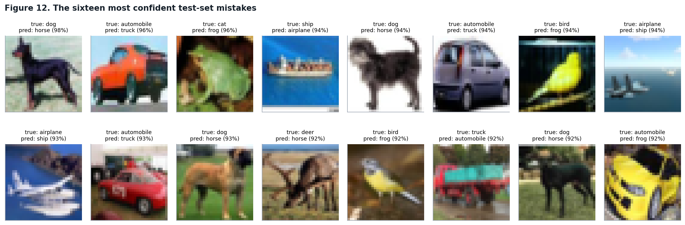
*Figure 12. The sixteen most confident mistakes on the test set.*

### 4.7 Summary and robustness

**Table 7.** Summary comparison across the tuning stages. Only the final model was evaluated on the test set.

| Configuration | Best val. accuracy | Best epoch | Parameters | Key observation | Test accuracy |
| :--- | ---: | ---: | ---: | :--- | ---: |
| Baseline (batch 128, no BN) | 48.68% | 21 | 1,738,890 | Peaks at epoch 21, then overfits | — |
| Best batch size (512, no BN) | 49.78% | 30 | 1,738,890 | Chosen by the noise-band rule | — |
| Batch normalization (batch 512) | 40.64% | 22 | 1,741,578 | Dense → BatchNorm → ReLU, all else fixed | — |
| Best random-search trial | 51.06% | 23 | 856,586 | Noisy validation curve (±2.2 pp per epoch) | — |
| Best Bayesian (TPE) trial | 53.14% | 27 | 989,706 | Small train–val gap, capacity-limited | — |
| **Final selected model** (`bayes_t2`) | 53.14% | 27 | 989,706 | One-standard-error rule on validation | **53.05%** |

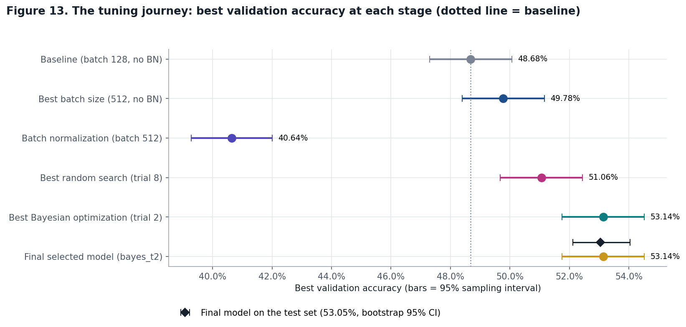
*Figure 13. Best validation accuracy at each stage with 95% sampling intervals; the diamond shows the final model's test accuracy.*

From the baseline's 48.68% to the final model's 53.14%, tuning changed best validation accuracy by +4.46 pp, a difference that clears both the 1-pp noise band and a paired McNemar test (p < 0.001). Of the individual stages, searching the full space (dropout, depth, width and learning rate) produced the largest single step (+12.50 pp, measured from the batch-normalized reference); choosing the batch size added +1.10 pp, and adding batch normalization on its own cost 9.14 pp. Measured against the best plain network (49.78% at batch 512) rather than the weakened batch-norm reference, the search added 3.36 pp. In 5 of the 6 fixed 30-epoch runs, validation accuracy peaked at least three epochs before training ended, and keeping the best-epoch weights instead of the last-epoch weights was worth +2.30 pp on average. Across all 22 runs that did not fail, best validation accuracy spanned only 40.64% to 53.14%.

Retraining the final configuration with seeds 7, 2024 and 31337 gave best validation accuracies of 51.80%, 51.76% and 51.80%. Together with the original run, the mean is 52.13% with a standard deviation of 0.68 pp, which is smaller than the 1-pp noise band. The original run ranked first of the four, a small illustration of the winner's curse: the configuration was selected partly on a favourable first seed.

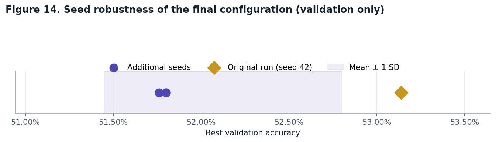
*Figure 14. Best validation accuracy of the final configuration across four seeds.*

## 5. Discussion

**RQ1: Under a fixed budget, batch size changed both the path and the destination.** Batch size mainly changed how training unfolded. At batch 32 the network made 1,407 updates per epoch and its validation accuracy moved by about 0.75 pp from epoch to epoch; at batch 512 it made 88 updates and moved by 0.73 pp. Best validation accuracies were 46.94%, 48.68% and 49.78% for batch sizes 32, 128 and 512. Comparing runs by epoch alone would have suggested that small batches learn faster, but per update the large batch made more progress, and per second it was eight times cheaper. Its small accuracy advantage is best explained by the budget: 2,640 updates left the network near its best point rather than past it. Once batch normalization and dropout were added in the searches the trend reversed, which shows that the right batch size depends on the rest of the configuration.

**RQ2: Batch normalization is only as good as the setting it is used in.** Batch normalization never reached the convergence target (47.3%, 95% of the plain network's best), which the plain network reached in epoch 8, and it finished with a best validation accuracy of 40.64% against 49.78% without it. The normalized network fitted 95% of its training set, so the optimization benefit described by Santurkar et al. (2018) was real, but without other regularization it simply memorized faster, and at 88 updates per epoch its running statistics lagged behind the weights. In the searches, the same layer appeared in every strong configuration once it was paired with dropout and small batches. The unregularized baseline ended its 30 epochs with a 17.01 pp gap between training and validation accuracy, while the final model's gap at its selected epoch was -1.12 pp, negative because dropout is active whenever training accuracy is measured. Across the sixteen search trials, mean best validation accuracy was 42.96% at dropout 0, 47.46% at dropout 0.2 and 50.40% at dropout 0.4. Dropout was the decisive regularizer (Srivastava et al., 2014): all five dropout-free search trials scored below all eleven that used it.

**RQ3: At eight trials, luck and protocol matter more than the search method.** Under the same eight-trial budget, random search's best trial reached 51.06% and Bayesian optimization's reached 53.14%, a difference that clears both the 1-pp noise band and a paired McNemar test (p < 0.001). Measured against a target of 1 pp below the overall best, random search never got there within its eight trials, and Bayesian optimization first got there in trial 2. The headline favours Bayesian optimization, but its best configuration came from a random warm-up draw, and none of the five model-guided trials improved on it. What the guided trials did show was the start of learning: they concentrated on dropout and small batches, and none was unstable, against four unstable random-search trials. Published gains from Bayesian optimization usually appear over dozens to hundreds of evaluations (Shahriari et al., 2016). Pooled over both searches, dropout produced the widest spread in mean validation accuracy (7.44 pp). Of the 16 search trials, 4 were unstable or failed, and 2 of those used a learning rate of 0.005. The most consequential configuration choice was invisible in the results tables: with Optuna's default warm-up of ten trials, both searches would have been random.

**RQ4: A defensible final model.** The final model (4 hidden layers of 256 units, with batch normalization, dropout 0.4, learning rate 0.0001 and batch size 32) reached 53.14% on validation and 53.05% on the test set (95% CI 52.12% to 54.04%), and across four seeds its validation accuracy averaged 52.13% (SD 0.68 pp). It was chosen by a rule fixed before the test set was opened; it is the best validation result and also the simplest stable model inside the noise band of that result; and its test score was measured exactly once and reported with an uncertainty interval. Test accuracy landed within 0.1 pp of validation, so the selection does not appear to have overfit the validation set. The seed check adds a caution: across four seeds the configuration averaged 52.13%, so the 53.14% it was selected on was about 1 pp lucky, a small instance of the winner's curse that a single-seed study cannot see.

## 6. Limitations and threats to validity

- **One seed per configuration.** Apart from the robustness check, each configuration was trained once, so rankings within the seed-to-seed spread are ties (Bouthillier et al., 2021).
- **Validation reuse.** More than twenty runs, and each run's best epoch, were chosen on the same 5,000 images, which makes the best validation score optimistic.
- **Small budget.** Sixteen trials cover under 4% of a 432-point grid. The search comparison holds at this budget only.
- **Epoch cap and patience.** A 30-epoch cap with a patience of 8 favours configurations that learn quickly, and it may judge very small learning rates before they converge.
- **Timing.** Wall-clock figures depend on the hardware. The ratios between settings transfer to other machines better than the absolute seconds do.

## 7. Recommendations and future work

1. Within this search space, the evidence supports 4 hidden layers of 256 units, with batch normalization, dropout 0.4, learning rate 0.0001 and batch size 32 as a sound default, and across all sixteen search trials dropout was the hyperparameter with the widest spread in mean validation accuracy, so it is the first one I would tune more finely. Use batch normalization only together with dropout and small batches.
2. Add a learning-rate schedule such as cosine annealing (Loshchilov & Hutter, 2017) and search the learning rate on a continuous log scale.
3. With a larger budget, use multi-fidelity search such as Hyperband (Li et al., 2018), and rerun the top configurations over several seeds before declaring a winner.
4. Widen the dropout range beyond 0.4 and allow more epochs for small learning rates: accuracy was still rising at the top of the dropout range, and the final model peaked at epoch 27 of 30.
5. For substantive accuracy gains, change the architecture: convolutional layers and simple data augmentation address the bottleneck identified in Section 4.1 (Goodfellow et al., 2016).

## 8. Reproducibility statement

All code, settings and decision rules live in the notebook, and every number in this report is regenerated from its exported logs by `make report`. Seeds, data split, epoch caps, patience, thresholds and the search space are set in one configuration cell. Op determinism is enabled, so rerunning on the same hardware and software versions should reproduce the results; across different GPUs or library versions, small numerical differences are expected. The full log of every run is listed in Appendix A.

## 9. Conclusion

On a deliberately limited architecture, careful tuning moved validation accuracy by +4.46 pp, and the evidence for each step is stated with its uncertainty. The more durable results are about method rather than about this model. Measure batch size on every clock, configure Bayesian optimization so that it actually models something within the budget, define "better" relative to the noise of the evaluation set, and spend the test set only once.

---

## References

Akiba, T., Sano, S., Yanase, T., Ohta, T., & Koyama, M. (2019). Optuna: A next-generation hyperparameter optimization framework. In *Proceedings of the 25th ACM SIGKDD International Conference on Knowledge Discovery & Data Mining* (pp. 2623–2631). Association for Computing Machinery. https://doi.org/10.1145/3292500.3330701

Bergstra, J., Bardenet, R., Bengio, Y., & Kégl, B. (2011). Algorithms for hyper-parameter optimization. In *Advances in Neural Information Processing Systems 24* (pp. 2546–2554). Curran Associates.

Bergstra, J., & Bengio, Y. (2012). Random search for hyper-parameter optimization. *Journal of Machine Learning Research, 13*, 281–305. https://www.jmlr.org/papers/v13/bergstra12a.html

Bouthillier, X., Delaunay, P., Bronzi, M., Trofimov, A., Nichyporuk, B., Szeto, J., Mohammadi Sepahvand, N., Raff, E., Madan, K., Voleti, V., Ebrahimi Kahou, S., Michalski, V., Arbel, T., Pal, C., Varoquaux, G., & Vincent, P. (2021). Accounting for variance in machine learning benchmarks. *Proceedings of Machine Learning and Systems, 3*, 747–769. https://arxiv.org/abs/2103.03098

Dietterich, T. G. (1998). Approximate statistical tests for comparing supervised classification learning algorithms. *Neural Computation, 10*(7), 1895–1923. https://doi.org/10.1162/089976698300017197

Goodfellow, I., Bengio, Y., & Courville, A. (2016). *Deep learning*. MIT Press. https://www.deeplearningbook.org

Goyal, P., Dollár, P., Girshick, R., Noordhuis, P., Wesolowski, L., Kyrola, A., Tulloch, A., Jia, Y., & He, K. (2017). *Accurate, large minibatch SGD: Training ImageNet in 1 hour* (arXiv:1706.02677). arXiv. https://doi.org/10.48550/arXiv.1706.02677

Guo, C., Pleiss, G., Sun, Y., & Weinberger, K. Q. (2017). On calibration of modern neural networks. In *Proceedings of the 34th International Conference on Machine Learning* (pp. 1321–1330). PMLR.

Hastie, T., Tibshirani, R., & Friedman, J. (2009). *The elements of statistical learning: Data mining, inference, and prediction* (2nd ed.). Springer. https://doi.org/10.1007/978-0-387-84858-7

Hoffer, E., Hubara, I., & Soudry, D. (2017). Train longer, generalize better: Closing the generalization gap in large batch training of neural networks. In *Advances in Neural Information Processing Systems 30* (pp. 1731–1741). Curran Associates.

Ioffe, S., & Szegedy, C. (2015). Batch normalization: Accelerating deep network training by reducing internal covariate shift. In *Proceedings of the 32nd International Conference on Machine Learning* (pp. 448–456). PMLR.

Keras Team. (n.d.). *BayesianOptimization tuner* [Software documentation]. KerasTuner. Retrieved October 20, 2026, from https://keras.io/keras_tuner/api/tuners/bayesian/

Keskar, N. S., Mudigere, D., Nocedal, J., Smelyanskiy, M., & Tang, P. T. P. (2017). On large-batch training for deep learning: Generalization gap and sharp minima. In *5th International Conference on Learning Representations*. https://arxiv.org/abs/1609.04836

Krizhevsky, A. (2009). *Learning multiple layers of features from tiny images* [Technical report]. University of Toronto. https://www.cs.toronto.edu/~kriz/learning-features-2009-TR.pdf

Li, L., Jamieson, K., DeSalvo, G., Rostamizadeh, A., & Talwalkar, A. (2018). Hyperband: A novel bandit-based approach to hyperparameter optimization. *Journal of Machine Learning Research, 18*(185), 1–52. https://jmlr.org/papers/v18/16-558.html

Loshchilov, I., & Hutter, F. (2017). SGDR: Stochastic gradient descent with warm restarts. In *5th International Conference on Learning Representations*. https://arxiv.org/abs/1608.03983

Masters, D., & Luschi, C. (2018). *Revisiting small batch training for deep neural networks* (arXiv:1804.07612). arXiv. https://doi.org/10.48550/arXiv.1804.07612

Optuna Contributors. (n.d.). *optuna.samplers.TPESampler* [Software documentation]. Optuna. Retrieved October 20, 2026, from https://optuna.readthedocs.io/en/stable/reference/samplers/generated/optuna.samplers.TPESampler.html

Raschka, S. (2018). *Model evaluation, model selection, and algorithm selection in machine learning* (arXiv:1811.12808). arXiv. https://doi.org/10.48550/arXiv.1811.12808

Santurkar, S., Tsipras, D., Ilyas, A., & Madry, A. (2018). How does batch normalization help optimization? In *Advances in Neural Information Processing Systems 31* (pp. 2483–2493). Curran Associates.

Shahriari, B., Swersky, K., Wang, Z., Adams, R. P., & de Freitas, N. (2016). Taking the human out of the loop: A review of Bayesian optimization. *Proceedings of the IEEE, 104*(1), 148–175. https://doi.org/10.1109/JPROC.2015.2494218

Smith, S. L., Kindermans, P.-J., Ying, C., & Le, Q. V. (2018). Don't decay the learning rate, increase the batch size. In *6th International Conference on Learning Representations*. https://arxiv.org/abs/1711.00489

Snoek, J., Larochelle, H., & Adams, R. P. (2012). Practical Bayesian optimization of machine learning algorithms. In *Advances in Neural Information Processing Systems 25* (pp. 2951–2959). Curran Associates.

Srivastava, N., Hinton, G., Krizhevsky, A., Sutskever, I., & Salakhutdinov, R. (2014). Dropout: A simple way to prevent neural networks from overfitting. *Journal of Machine Learning Research, 15*(56), 1929–1958. https://jmlr.org/papers/v15/srivastava14a.html

Watanabe, S. (2023). *Tree-structured Parzen estimator: Understanding its algorithm components and their roles for better empirical performance* (arXiv:2304.11127). arXiv. https://doi.org/10.48550/arXiv.2304.11127

---

## Appendix A. Every run

| Run | Stage | Best val. accuracy | Best epoch | Epochs run | Parameters | Status | Time (s) |
| :--- | :--- | ---: | ---: | ---: | ---: | :--- | ---: |
| `bayes_t2` | Step 6: bayes search | 53.14% | 27 | 30 | 989,706 | ok | 300 |
| `seed7_bayes_t2` | Robustness check | 51.80% | 25 | 30 | 989,706 | ok | 298 |
| `seed31337_bayes_t2` | Robustness check | 51.80% | 29 | 30 | 989,706 | ok | 298 |
| `seed2024_bayes_t2` | Robustness check | 51.76% | 29 | 30 | 989,706 | ok | 299 |
| `bayes_t5` | Step 6: bayes search | 51.24% | 28 | 30 | 2,108,426 | ok | 260 |
| `random_t8` | Step 5: random search | 51.06% | 23 | 30 | 856,586 | unstable | 216 |
| `random_t7` | Step 5: random search | 50.40% | 27 | 30 | 428,810 | ok | 135 |
| `bs512` | Step 3: batch size | 49.78% | 30 | 30 | 1,738,890 | ok | 22 |
| `bayes_t7` | Step 6: bayes search | 49.42% | 21 | 29 | 989,706 | ok | 79 |
| `random_t5` | Step 5: random search | 49.04% | 13 | 21 | 989,706 | ok | 60 |
| `baseline` | Step 2: baseline | 48.68% | 21 | 30 | 1,738,890 | ok | 54 |
| `bayes_t4` | Step 6: bayes search | 48.50% | 28 | 30 | 445,706 | ok | 297 |
| `bayes_t8` | Step 6: bayes search | 48.28% | 20 | 28 | 428,810 | ok | 66 |
| `nobn_lr005_bs512` | Step 4 extension | 47.60% | 24 | 30 | 1,738,890 | ok | 22 |
| `bs32` | Step 3: batch size | 46.94% | 15 | 30 | 1,738,890 | ok | 176 |
| `random_t1` | Step 5: random search | 46.74% | 26 | 30 | 2,372,618 | unstable | 44 |
| `random_t6` | Step 5: random search | 46.26% | 6 | 14 | 2,372,618 | unstable | 40 |
| `random_t2` | Step 5: random search | 45.60% | 7 | 15 | 856,586 | ok | 19 |
| `bayes_t3` | Step 6: bayes search | 45.32% | 9 | 17 | 445,706 | ok | 26 |
| `random_t3` | Step 5: random search | 44.92% | 3 | 11 | 445,706 | ok | 55 |
| `bn_lr005_bs512` | Step 4 extension | 43.08% | 5 | 30 | 1,741,578 | unstable | 26 |
| `bayes_t6` | Step 6: bayes search | 42.78% | 6 | 14 | 856,586 | ok | 97 |
| `bayes_t1` | Step 6: bayes search | 41.04% | 4 | 12 | 989,706 | ok | 19 |
| `random_t4` | Step 5: random search | 40.76% | 5 | 13 | 428,810 | unstable | 30 |
| `bn_bs512` | Step 4: batch normalization | 40.64% | 22 | 30 | 1,741,578 | unstable | 26 |

## Appendix B. Per-class test accuracy of the final model

| Class | Test accuracy |
| :--- | ---: |
| dog | 31.40% |
| bird | 36.50% |
| cat | 45.10% |
| deer | 48.20% |
| airplane | 57.90% |
| automobile | 58.30% |
| truck | 58.30% |
| frog | 62.60% |
| horse | 62.60% |
| ship | 69.60% |
